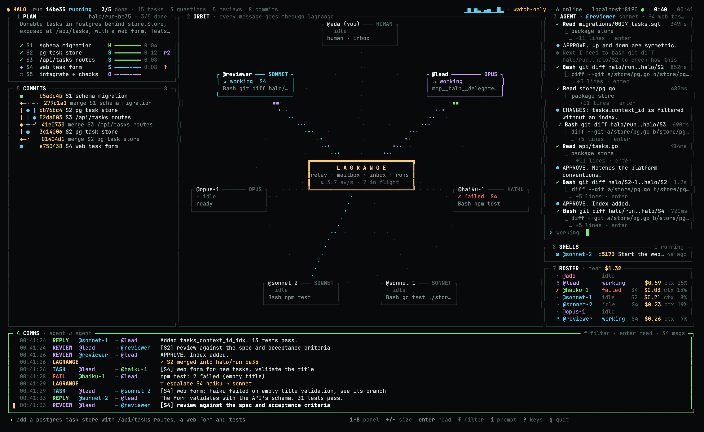
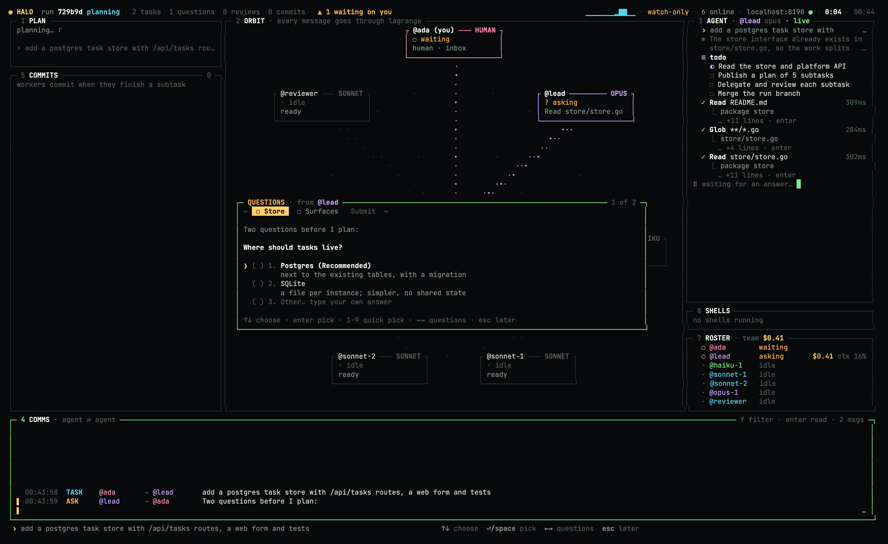
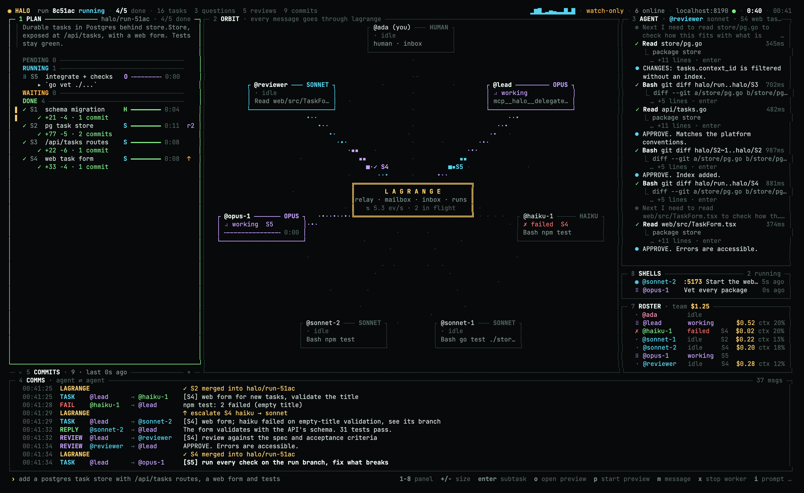
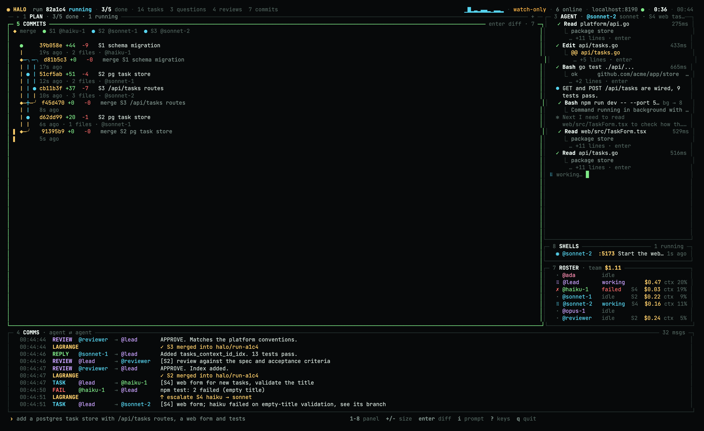
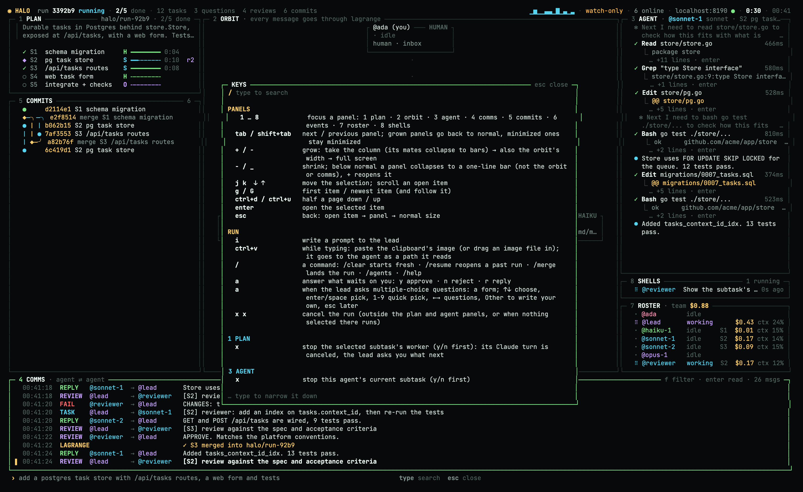
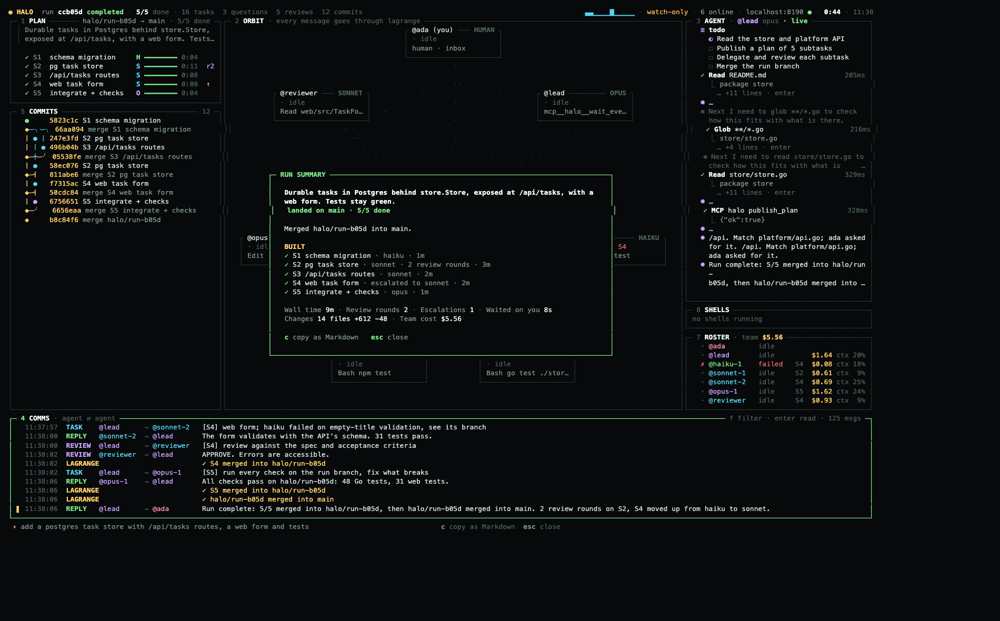
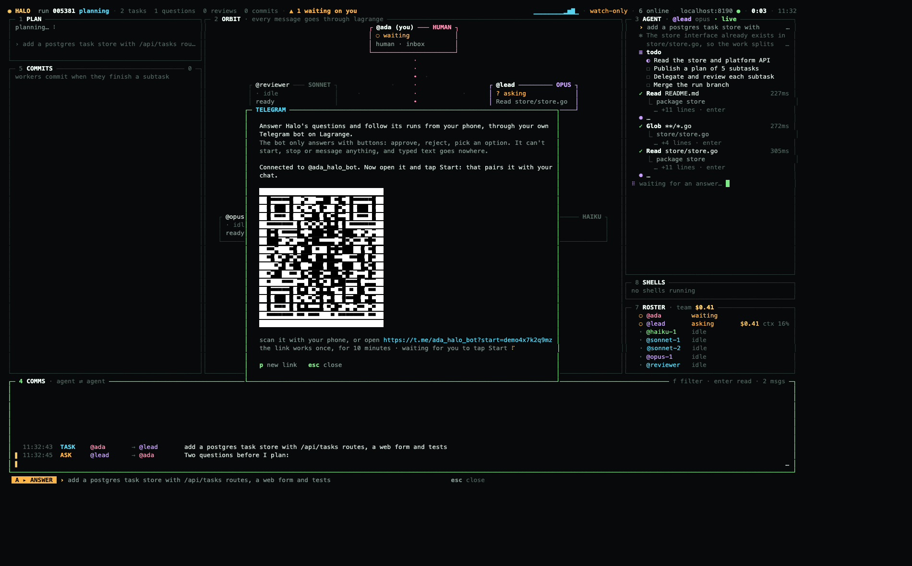
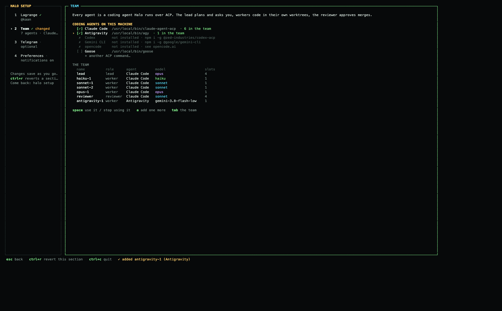
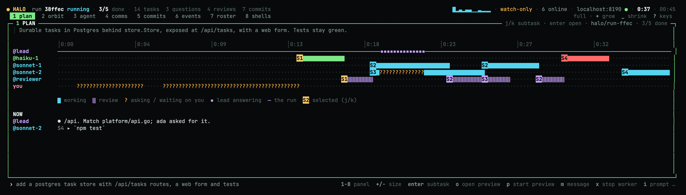

<div align="center">

<picture>
<source media="(prefers-color-scheme: dark)" srcset="docs/brand/mascot-dark.svg">

</picture>

# Halo

**A team of Claude Code agents that work together over [A2A](https://a2a-protocol.org): a lead, workers on haiku, sonnet and opus, and a reviewer, each with its own address, delegating to each other in the open.**

### ▶ Try the demo view: a simulated run, nothing to install

```sh
ssh halo.3agents.dev
```

A simulated team run plays in your terminal. Type `yes` once to accept the host key; no account and no password.

Most multi-agent coding tools are one process calling sub-agents behind a curtain. In Halo, every agent is a real A2A agent on a [Lagrange](https://github.com/three-agent-problem/lagrange) server, and so are you. When the lead delegates a subtask, a worker asks a question, the reviewer sends back CHANGES, or the lead asks you to approve the plan, that message is a durable A2A task between two addresses. You watch all of it live in your terminal, and you can replay it in Lagrange afterwards.

*A halo orbit circles a Lagrange point. Halo's agents circle a Lagrange server.*

[Step-by-step guide](docs/guide.md) · [Why A2A](#why-a2a) · [Panels and keys](#panels-and-keys) · [How a run goes](#how-a-run-goes) · [Findings](FINDINGS.md)



</div>

## What happens when you press enter

```
 you ── halo (TUI) ──A2A──▶  Lagrange  ◀──tunnels── the team (hosted by halo)
          ▲  /api/events       │                    ├─ @halo-lead      opus: asks, plans, delegates, merges (never edits)
          └────────────────────┘                    ├─ @halo-haiku-1   workers: one git worktree per subtask
                                                    ├─ @halo-sonnet-1  ...
                                                    ├─ @halo-opus-1    ...
                                                    └─ @halo-reviewer  APPROVE / CHANGES (never edits)
```

1. **The lead asks first, if it has to.** An ambiguous goal gets up to four multiple-choice questions, like Claude Code's plan mode.
2. **You approve a plan.** It shows subtasks, models and dependencies. Nothing runs before you say yes, in the TUI, in Lagrange's inbox, or from an email or Slack link on your phone.
3. **Workers build in parallel.** Each works in its own git worktree of a run branch: cheap work goes to haiku, real work to sonnet, the hard parts to opus.
4. **A reviewer reads every diff.** CHANGES sends the subtask back to the same worker in the same Claude session. A failure escalates it one model up (haiku → sonnet → opus).
5. **It lands on your branch.** When every subtask is merged, Halo merges the run into the branch you started from and cleans up its worktrees.

## Why A2A

Because every hop goes through A2A on Lagrange instead of a function call inside one process, you get more than a TUI:

| | |
|---|---|
| **Every agent is an address** | `@halo-lead`, `@halo-sonnet-1` and the rest each get an A2A endpoint and an agent card at `/a/<handle>/.well-known/agent-card.json`. They are the same kind of thing as any other agent on the server. |
| **Every hop is a task** | A delegation, a worker's question, a review or a merge conflict is an A2A task with a state (`WORKING`, `INPUT_REQUIRED`, `COMPLETED`, `FAILED`), its history and artifacts. Lagrange stores it in Postgres, so the task outlives the process that sent it. |
| **You are an address too** | The plan approval is an `INPUT_REQUIRED` task sent to *you*. It waits in your Lagrange inbox, on the live graph, and in an email or Slack link that opens on your phone. Answer wherever you are, and the run goes on. |
| **The team runs anywhere** | The agents connect out through Lagrange tunnels. Halo hosts them on your laptop, or `halo agents` runs them headless on a beefier box while you watch from anywhere with `halo -watch`. |
| **Every run is replayable** | Lagrange's **Runs** page tells the run as numbered steps next to a sequence diagram, steps through it with `←`/`→`, and keeps every HTTP request and response behind each hop. |
| **Nothing is locked in** | It's A2A from end to end: the open protocol, the official [a2a-go](https://github.com/a2aproject/a2a-go) SDK, and Claude Code over the [Agent Client Protocol](https://agentclientprotocol.com). |

## Try it in 10 seconds (no server, no agents)

```sh
brew install three-agent-problem/tap/halo     # or: go install github.com/three-agent-problem/halo/cmd/halo@latest
halo --demo
```

The demo plays a scripted run: questions, a plan to approve, five subtasks, a failed haiku escalated to sonnet, review rounds, merges. Press `a` to answer, `+` to grow a panel, `?` for every key.

## Run it for real

**→ Follow [the step-by-step guide](docs/guide.md).** It goes from nothing to a merged run in about 10 minutes and shows what you should see at every step. The short version:

```sh
# 1. a Lagrange server (Docker)
git clone https://github.com/three-agent-problem/lagrange && cd lagrange
cp .env.example .env            # set LAGRANGE_PUBLIC_URL=http://localhost:8080 and the admin account
docker compose up -d            # http://localhost:8080

# 2. Claude Code (logged in once) and its ACP adapter, then Halo
npm i -g @agentclientprotocol/claude-agent-acp
brew install three-agent-problem/tap/halo

# 3. an API key: Lagrange → Settings → API keys → Create key

# 4. go
cd ~/code/your-repo && halo      # asks for the server and the key once, then hosts the team
```

## Screens

| | |
|---|---|
|  |  |
| **Questions first.** Pick an option, or write your own. Lagrange's inbox, email and Slack show the same questions as text. | **`1` `+`: the plan grows into a kanban.** It shows each worker's live line, diff stats and review rounds (`r2`). `↑` marks an escalation. |
|  |  |
| **`5` `+`: the commit graph, live.** One lane per subtask branch, colored by model, with merges as `◆`. `enter` opens the diff. | **`?`: every key, searchable.** Type to narrow it down. |

|  |  |
| **The run summary.** It opens when the run lands (`/summary` reopens it): what was built, wall time, review rounds, escalations, cost. `c` copies it as Markdown. | **`/connections`: Telegram.** Paste a @BotFather token, scan the code, and questions reach your phone with buttons to answer. |


<sub>**`halo setup`**: tick the coding agents Halo may use (it finds the installed ones), then set each agent's model, command and slots. The server, Telegram and preferences are the other sections.</sub>


<sub>**`1` `+` `+` `+`: the plan at full size** is a timeline with a lane per agent: working, in review, waiting on you, and what each one does now.</sub>

## Panels and keys

It works like lazygit: every panel has a number, and `enter` opens the selected item. `+` grows the focused panel in steps: first its whole column (the panels above and below collapse to one-line bars), then the orbit's width too, then the whole screen. `-` shrinks it, and below normal size the panel collapses to a one-line bar. Moving the focus puts grown panels back to normal size.

| Panel | Shows | `enter` opens |
|---|---|---|
| `1` plan | Subtasks, models, progress, and what each running worker is doing now. Grown: a kanban. Full size: a timeline per agent. | The subtask: status, attempts, commits and every message about it. |
| `2` orbit | Every message travelling through Lagrange. | (grows it) |
| `3` agent | The agent's raw Claude Code output: thinking, messages and tool calls with their output. `v` switches to the tool calls Lagrange saw, and `h`/`l` switch agents. | A tool call's full input and output. |
| `4` comms | Agent ⇄ agent messages. `f` filters by agent. `+` makes it taller, then gives it the left side with every other panel compact on the right (you keep talking while the run stays in view), then the full screen with your past runs beside it: `[` `]` pick one, `o` opens it. | The whole message. |
| `5` commits | The run's commits as a live branch graph. | The diff (`[` `]` previous/next). |
| `6` events | The raw Lagrange activity feed. | The entry as JSON. |
| `7` roster | The team, with each agent's cost and context fill. `n` adds an agent, `m` changes its model, `d d` removes it and `R` restarts it. | (watches that agent in `3`) |
| `8` shells | Every command the agents run and every server they leave up, with its ports. `o` opens a port, and `d d` stops a command and its children. | Live output, command, cwd and ports. |

| Key | Does |
|---|---|
| `1`–`8`, `tab` | Focus a panel. |
| `+` / `-` | Grow or shrink it: bar → normal → column → wide → full. |
| `j` `k` `g` `G` `ctrl+d` `ctrl+u` | Move and scroll. |
| `enter` / `esc` | Open / go back. |
| `i` | Prompt the lead. During a run, what you send is a **btw**: a side question the lead answers between its steps, with no new run and no change to the plan. A prompt that would start a new run asks y/n first, and `/new <prompt>` starts one on purpose. |
| `a` | Answer what is waiting on you: `y` approves, `n` rejects, `r` replies. The lead's multiple-choice questions open as a form. |
| `/` | Commands: `/new` starts a run, `/btw` asks on the side, `/clear` starts fresh, `/resume` reopens a past run, `/merge` lands the run now, `/summary` shows the run summary, `/connections` connects Telegram, plus `/agents` and `/help`. |
| `ctrl+v` | While typing: paste a screenshot from the clipboard, or drag in an image file. |
| `x` | In the plan or agent panel: stop that subtask's worker (asks y/n first). Elsewhere, `x` `x` cancels the run. |
| `?` | Every key. Type to search. |
| `q` | Quit. If a run is in flight, it asks first, because the agents stop with Halo. |

When something new waits on you and the terminal isn't focused, Halo sends a desktop notification (OSC 9, in iTerm2, Ghostty, WezTerm or kitty) and rings the bell. `notify: false` in `halo.yaml` turns this off.

## How a run goes

The lead orchestrates only through MCP tools. Each tool call is a Lagrange task, and Halo enforces the rules in Go, not in the prompt:

| Tool | What it does |
|---|---|
| `ask_human` | Asks you something: up to 4 multiple-choice `questions`, or a plan approval. It shows in the TUI and in your Lagrange inbox, and reaches your phone by Telegram (with buttons), email or Slack. |
| `publish_plan` | The goal and the subtasks (id, spec, acceptance, model, deps). The plan streams to the TUI as the `halo.plan` artifact. |
| `delegate` | Sends a subtask whose dependencies are merged to the least busy worker of its model, in a fresh worktree of `halo/<run>`. |
| `wait_events` | Waits for what happened: worker questions (`ask_lead`, answered with `answer`), finished or failed subtasks, reviews, merge conflicts, your answers. |
| `request_review` | The reviewer reads the diff. APPROVE merges the subtask into the run branch. CHANGES leads to `follow_up`: the same worker, in the same Claude session, for at most 2 rounds. |
| `escalate` | Retries a failed subtask one model up. |

Once every subtask is merged, Halo merges `halo/<run>` into the branch you started from. If that fails, `halo merge <run>` retries it later, and `halo merge` on its own lists runs.

All along, the run keeps a **situation report** on its root task (Lagrange's `report` extension): status, progress, what each merged subtask built (model, review rounds, time), wall time, review rounds, escalations, time spent waiting on you, and the diff size. Lagrange's Runs page shows it as a card, Telegram gets its notices (a subtask failed, an escalation, a conflict, landed), and when the run lands the TUI opens it as the run summary. `halo merge` prints it too.

## Telegram

Step away and keep the run moving: `/connections` in the TUI (or `halo connections`) links your own Telegram bot to your Lagrange account. The bot lives in Lagrange, not in Halo, so Lagrange → Settings → Telegram is the same connection, and it works for any agent that asks you something.

1. In Telegram, open @BotFather, send `/newbot`, and paste the token it gives you.
2. Scan the QR code (or open the link) and tap **Start**. That pairs the bot with your chat. The link works once, for 10 minutes.
3. Halo sends a test message. `l` switches between *only questions* and *questions plus runs' news and summaries*. `d` `d` disconnects the bot, to start over.

What reaches Telegram: the lead's questions as option buttons, the plan approval as Approve/Reject (Approve asks again), reminders and escalations, notices from the run report, and the run summary when it ends. When you answer in the TUI or the inbox, the Telegram message updates itself.

**It can't do much, on purpose.** The bot only answers with its buttons, and only in your private chat with the paired Telegram account. It can't start, stop, cancel or message anything, typed text gets a fixed refusal, and messages never carry a link that would let you type an answer. Besides buttons it knows `/status`, `/waiting`, `/runs`, `/mute`, `/unmute` and `/help`. A `✈` in the footer means a bot is paired.

## Good to know

- **The agents run Claude Code without asking per tool call.** Workers may do anything inside their own worktree. The lead and the reviewer can't edit files. The worktrees live outside your repo, in `~/Library/Caches/halo/<repo>-<hash>/`.
- **One team, one host.** The team is global (`~/Library/Application Support/halo/roster.yaml`, edited in panel 7). A `halo.yaml` in a repository overrides it for that repository only. If the team is already online in another Halo, this one opens watch-only. `halo -watch` watches on purpose, and `halo agents` runs the team headless on another machine.
- **Watching from elsewhere.** Everything but the shells panel comes through Lagrange: tool calls with their output, thoughts, costs, commits and their diffs. So a watch-only Halo on another machine sees what the host sees.
- **Runs persist.** `/resume` reopens any past run with its whole history, and your next prompt continues that conversation, so the lead remembers it, even across restarts.
- **Cost.** Every agent is a real Claude Code session on your account. The roster shows each one's cost (Claude Code's estimate at API prices).

| Command | |
|---|---|
| `halo` | The TUI. It hosts the team on this repository unless another Halo already does. |
| `halo --demo` | A scripted run, with no server needed. |
| `halo -watch` | Watch only. |
| `halo setup` | One screen for Lagrange (server and key; `o` opens it in the browser), the team (it finds the coding agents installed here: Claude Code, Antigravity, Codex, Gemini CLI, opencode, Goose, or any ACP command you type), Telegram and preferences. A first run opens it; come back any time. Changes save as you go, and `ctrl+r` puts the section you're in back to how it was when setup opened (it asks y/n first). |
| `halo init --server URL --key lgk_…` | Save the server and key, and create the addresses, with flags (for scripts). |
| `halo agents` | Run the team headless. |
| `halo merge [run] [--keep]` | List finished runs, or merge one into the checked-out branch, then print its summary. |
| `halo connections [--level questions\|milestones] [--pair] [--test] [--disconnect]` | Connect Telegram in the terminal (token hidden, QR code to pair); `--disconnect` starts over. |
| `halo version` | The installed version. |

## Built on

[Lagrange](https://github.com/three-agent-problem/lagrange) (addresses, tunnels, mailboxes, the inbox and runs), [a2a-go](https://github.com/a2aproject/a2a-go) (A2A and its ACP executor), [Claude Code](https://claude.com/claude-code) over the [Agent Client Protocol](https://agentclientprotocol.com), and [Bubble Tea](https://github.com/charmbracelet/bubbletea).

Halo is also Lagrange's dogfood: every gap it hits is written down, with a repro, in [FINDINGS.md](FINDINGS.md).

Apache 2.0.
