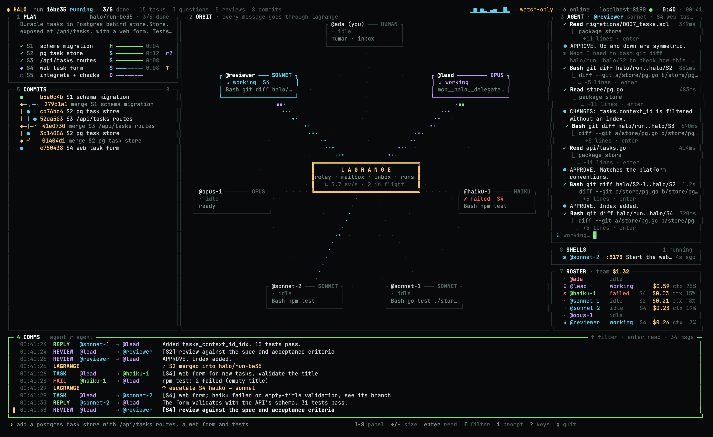
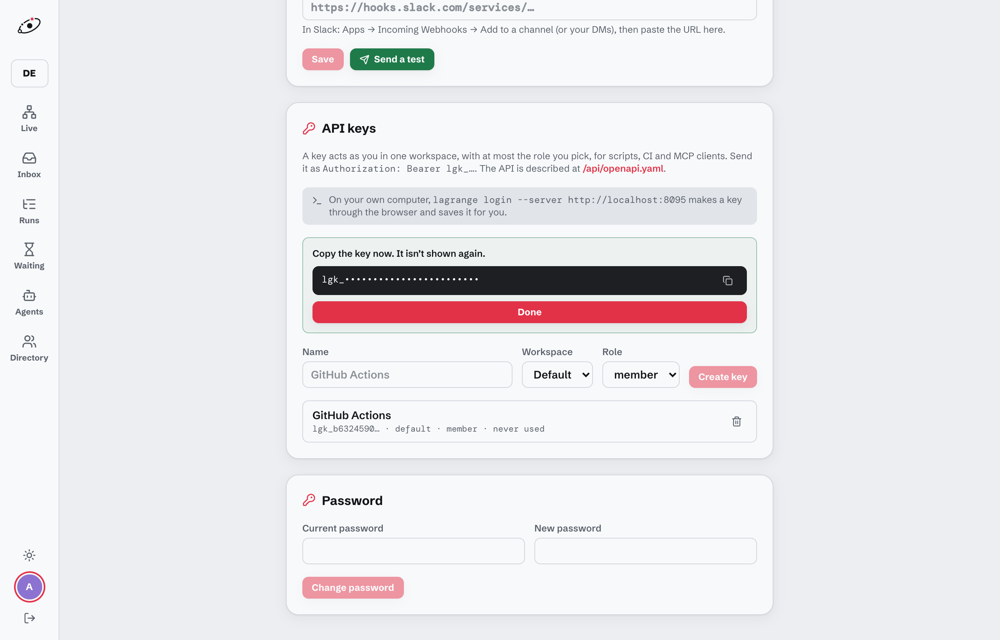
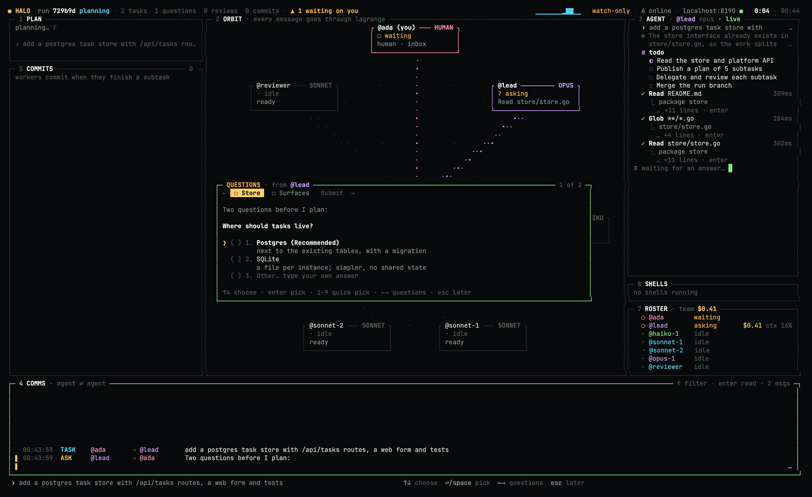
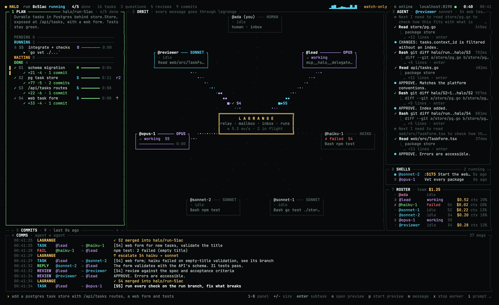

# Halo + Lagrange, step by step

From nothing to a merged run in about 10 minutes. Every step ends with **✅ You should see**, so you know it worked before you move on. If something doesn't match, jump to [When something's off](#when-somethings-off).

```
 Step 1  Lagrange running        http://localhost:8080
 Step 2  Claude Code + adapter   claude-agent-acp on your PATH
 Step 3  Halo installed          halo --demo works
 Step 4  An API key              lgk_…
 Step 5  First launch            the team goes online
 Step 6  First run               prompt → questions → plan → approve
 Step 7  Watch it                panels, Lagrange's web app
 Step 8  It lands                merged into your branch
```

**You need:** macOS or Linux, [Git](https://git-scm.com), [Homebrew](https://brew.sh) (or Go 1.26+), [Node 20+](https://nodejs.org), [Docker](https://www.docker.com/products/docker-desktop/), and a Claude account for Claude Code.

---

## Step 1 · Start a Lagrange server

Lagrange is the server every message goes through. Run it locally with Docker:

```sh
git clone https://github.com/three-agent-problem/lagrange
cd lagrange
cp .env.example .env
```

Open `.env` and set these five lines (any password works locally):

```sh
POSTGRES_PASSWORD=pick-anything
LAGRANGE_PUBLIC_URL=http://localhost:8080
LAGRANGE_ADMIN_EMAIL=you@example.com
LAGRANGE_ADMIN_PASSWORD=pick-a-password
LAGRANGE_ADMIN_HANDLE=you
```

Then start it. The first build takes a few minutes:

```sh
docker compose up -d
```

✅ **You should see:** `docker compose ps` shows `lagrange` as `healthy`, and http://localhost:8080 shows a login page. Log in with the email and password from `.env`.

> Already have a Lagrange server (yours or your team's)? Skip this step and use its URL instead of `http://localhost:8080` everywhere below.

## Step 2 · Claude Code and its ACP adapter

Each agent on the team is a Claude Code session. Halo talks to it through the [Agent Client Protocol](https://agentclientprotocol.com) adapter.

1. Install [Claude Code](https://claude.com/claude-code) if you don't have it. Then run `claude` once and log in, so the agents can use your account.
2. Install the adapter:

   ```sh
   npm i -g @agentclientprotocol/claude-agent-acp
   ```

✅ **You should see:** `which claude-agent-acp` prints a path.

## Step 3 · Install Halo

```sh
brew install three-agent-problem/tap/halo
halo --demo
```

No Homebrew? Use `go install github.com/three-agent-problem/halo/cmd/halo@latest`, which puts `halo` in `$(go env GOPATH)/bin` (usually `~/go/bin`), so that directory must be on your `PATH`. Halo runs on macOS and Linux.

✅ **You should see:** the full TUI playing a scripted run. Press `a` when the lead asks something, `?` to see every key, and `q` then `y` to quit. Use a terminal of at least 160×44 for the full layout (80×24 is the minimum).



## Step 4 · Create an API key

Halo acts as you on Lagrange, so it needs one of your keys.

1. In Lagrange (http://localhost:8080), open **Settings** (your avatar, bottom left) and scroll to **API keys**.
2. Name it `halo`. Keep the workspace **Default** and the role **member**, which is enough. Click **Create key**.
3. Copy the `lgk_…` key now, because it isn't shown again.



> Have the `lagrange` CLI? `lagrange login --server http://localhost:8080` does this through the browser, and Halo picks up that login by itself, so you can skip pasting. On a machine without a browser, `lagrange login --server http://localhost:8080 --email you@example.com` asks for your password instead.

✅ **You should see:** a key starting with `lgk_` on your clipboard.

## Step 5 · Launch Halo in your repository

Halo works on the git repository you start it in. Use a real repo with at least one commit. Halo never touches your working tree until a run is approved and merged, and all the work happens in separate worktrees under `~/Library/Caches/halo/`.

```sh
cd ~/code/your-repo
halo
```

The first launch opens **halo setup** on its Lagrange section:

1. Press `enter` on **server** and type your server's URL (or keep `http://localhost:8080`), then `enter`.
2. Press `↓`, `enter`, and paste the API key from step 4, then `enter`. Halo checks it at once: `✓ you are @you on …`.
3. Optional, now or later: **Team** (`2`) lists the coding agents installed on this machine. Tick one with `space` to add a worker that runs it, and change models with `m`. **Telegram** (`3`) connects your phone. **Preferences** (`4`) has notifications and the preview command.
4. `o` opens Lagrange in your browser (not over SSH). Press `q` when done. Everything was saved as you went, and `ctrl+r` in a section puts it back to how it was when setup opened.

`halo setup` reopens it any time. In a script, `halo init --server URL --key lgk_…` does the server part with flags.

Halo then creates the team's addresses on Lagrange (`@halo-lead`, `@halo-haiku-1`, `@halo-sonnet-1`, `@halo-sonnet-2`, `@halo-opus-1`, `@halo-reviewer`), opens a tunnel for each one, and starts their Claude Code sessions.

✅ **You should see:**
- In the TUI, the top bar says **6 online**, and every agent in the orbit (panel `2`) reads `ready`.
- In Lagrange, **Agents** lists the six `halo-*` addresses as online.

## Step 6 · Your first run

Press **`i`**, type what you want built, and press **enter**. Start small, for example:

```
add a /healthz endpoint that returns the git sha, with a test
```

What happens next:

1. **The lead reads your repo** (panel `3` shows its tool calls live).
2. **It may ask you questions first.** The top bar shows `▲ 1 waiting on you`. Press **`a`**: each question is a form. Move with `↑`/`↓`, pick with `enter` or `space`, switch questions with `←`/`→`, or choose **Other…** to type your own answer.

   

3. **It publishes a plan and asks you to approve it.** Panel `1` lists the subtasks and the model each one gets. Press **`a`**, then:
   - **`y`** to approve it,
   - **`n`** to reject it,
   - **`r`** to reply with changes (for example "use the existing router, not a new one"). The lead revises the plan and asks again.

✅ **You should see:** after you approve, the plan's subtasks start moving from `○` to running, and workers light up in the orbit.

> You don't have to be at the terminal. The same questions wait in Lagrange's **Inbox**, and with email or Slack set up in Lagrange, they reach your phone as one-time answer links.

## Step 7 · Watch it work

Everything here is optional. The run goes on by itself.

| Want to… | Do |
|---|---|
| See the plan as a board | `1` then `+` (once more for wider, a third time for a timeline per agent) |
| Follow one agent's raw output | `3`, then `h`/`l` to switch agents |
| Read what agents tell each other | `4` (`f` filters by agent) |
| See commits as they land | `5` then `+`, and `enter` on a commit for its diff |
| See dev servers the agents started | `8`, and `o` opens the port in your browser |
| Stop a worker that went off track | `1`, select the subtask, then `x` (the lead asks you what next) |
| Message the lead mid-run | `i` |



**The same run in Lagrange's web app** (http://localhost:8080):
- **Live** shows the team as nodes, with every message as a packet moving between them.
- **Runs** opens this run as numbered steps next to a sequence diagram. Replay it with `←`/`→`, and open any step to see the HTTP behind it.
- **Inbox → Between agents** shows the lead and each worker as one chat.

## Step 8 · It lands on your branch

When every subtask has been reviewed and merged into `halo/<run>`, Halo merges that branch into the branch you started from and deletes its worktrees and branches.

✅ **You should see:**
- In comms (`4`): `✓ halo/run-xxxx merged into main` (or your branch name).
- In your repo:

  ```sh
  git log --oneline --graph -10   # the run's merge on top
  ```

The **run summary** opens on top: what each subtask built, wall time, review rounds, escalations and cost. `c` copies it as Markdown, `esc` closes it, and `/summary` brings it back.

Then press `i` for the next prompt. It continues the same conversation, so the lead remembers this run. `/clear` starts fresh, and `/resume` reopens any past run.

## Optional · Answer from your phone (Telegram)

Type `/connections` in the TUI (or run `halo connections`) and follow the three steps: create a bot with @BotFather (`/newbot`), paste its token (hidden as you type), then scan the QR code and tap **Start** in Telegram.

✅ **You should see:** "✓ paired" in the dialog, a test message in Telegram, and `✈` in the footer. From then on the lead's questions and the plan approval arrive in Telegram with buttons, and the run summary arrives when the run lands. The bot can only press those buttons and show status (`/status`, `/waiting`, `/runs`): it can't start or stop anything.

---

## When something's off

| Symptom | Fix |
|---|---|
| `checking the key on http://localhost:8080: …` | Is Lagrange up (`docker compose ps`)? Is the key copied whole, including `lgk_`? Is the URL the same one you log in with? |
| The top bar says **watch-only** | Halo says why when it starts. "not in a git repository": `cd` into a repo. "online in another Halo": another Halo already hosts the team, so quit that one or keep watching from here. |
| The agents never come online, or fail at once | Run `which claude-agent-acp` and check that `claude` is logged in (run `claude` and look for a login prompt). |
| `halo: command not found` | With `go install`, add `$(go env GOPATH)/bin` to your `PATH`. |
| Lagrange's Live page only updates on reload | A proxy is buffering server-sent events. Locally this doesn't happen. Behind nginx or Traefik, turn off buffering for `/api/events`. |
| The final merge failed (conflict with your branch) | Fix your branch, then run `halo merge <run>`. `halo merge` alone lists runs. |
| Telegram says "This bot is already connected" or nothing arrives | One bot, one Lagrange account: make a new bot for another account. Check `/connections` says paired, and that the bot isn't muted (`/unmute` in Telegram). Only one Lagrange server may poll a bot. |
| Start over with a different server or key | Delete `~/Library/Application Support/halo/state.json` (Linux: `~/.config/halo/state.json`) and run `halo` again. |

## Change the team

Open panel **`7`** (roster) in the TUI:
- `n` adds an agent,
- `m` changes an agent's model,
- `d d` removes an agent,
- `R` restarts an agent.

Changes save to `~/Library/Application Support/halo/roster.yaml` and apply to every repository. For one repository only, put a `halo.yaml` in it:

```yaml
prefix: halo
preview: npm run dev        # what `p` in the plan panel starts for a live preview
notify: true                # desktop ping when something waits on you
agents:
  - {name: lead,     model: opus,   role: lead,     capacity: 4}
  - {name: sonnet-1, model: sonnet, role: worker,   capacity: 1}
  - {name: sonnet-2, model: sonnet, role: worker,   capacity: 1}
  - {name: reviewer, model: sonnet, role: reviewer, capacity: 4}
```

### Other coding agents on the team

Any agent that speaks ACP can be a worker next to the Claude ones. Give that agent its own `acp:` command, and set `model:` to a model name that agent uses. For example, a cheap Gemini worker through the Antigravity CLI:

```yaml
agents:
  - {name: lead,     model: opus,   role: lead}
  - {name: sonnet-1, model: sonnet}
  - {name: agy-1,    model: gemini-3.8-flash-low, acp: agy acp --process-per-session}
  - {name: reviewer, model: sonnet, role: reviewer}
```

- The model is set as an ACP session option. `agy models` lists the names. `agy` needs 1.5 or later (for `agy acp`) and a one-time `agy acp --login`.
- Pass `--process-per-session` to `agy`: Halo gives every worker its tools as an HTTP MCP server, and agy only accepts those in that mode.
- The lead sees these workers as "not Claude" and gives them precisely specified work. Escalating a subtask from one moves it to the cheapest Claude model in the roster.
- Panel 7 keeps an agent's `acp:` when you edit the team, but `m` only cycles Claude models. Change other agents' models in the YAML.
